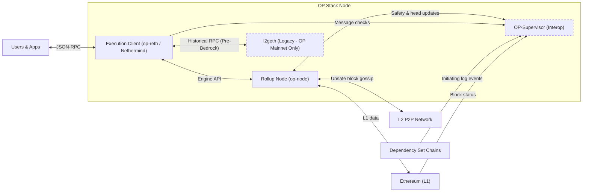

import OpGethEol from "/snippets/op-geth-eol.mdx"

This page explains how an OP Stack node is put together: what its components are, what each one is responsible for, and how they relate to the equivalent parts of an Ethereum node. It is background reading to build a mental model before you run a node; for the steps to actually stand one up, see the [Next steps](#next-steps) below.

Every OP Stack node is composed of two required core services: the **Rollup Node** (consensus client) and the **Execution Client** (execution engine).

Depending on the network and node role, an OP Stack node may also run two optional components:

*   **[OP-Supervisor](https://specs.optimism.io/interop/supervisor.html)** (`op-supervisor`): Required on chains participating in [OP Stack interoperability](/op-stack/interop/explainer) to verify cross-chain messages and coordinate cross-chain block safety levels.
*   **[Legacy Geth](/node-operators/guides/configuration/legacy-geth)** (`l2geth`): Optional and **only applicable to OP Mainnet** archive nodes that need to serve historical stateful execution queries for blocks created prior to the [Bedrock Upgrade](https://web.archive.org/web/20230608050602/https://blog.oplabs.co/introducing-optimism-bedrock/).

## Node flow diagram

The following diagram shows how the Rollup Node, Execution Client, OP-Supervisor, and Legacy Geth components work together to form a complete node running on OP Stack networks.
This diagram uses the `op-node` implementation of the Rollup Node and shows the general architecture that applies to all execution client implementations.

## Rollup node

The Rollup Node is responsible for deriving L2 block payloads from L1 data and passing those payloads to the Execution Client. The Rollup Node can also optionally participate in a peer-to-peer network to receive blocks directly from the Sequencer before those blocks are submitted to L1. The Rollup Node is largely analogous to a [consensus client](https://ethereum.org/en/developers/docs/nodes-and-clients/#what-are-nodes-and-clients) in Ethereum.

### Rollup node implementations

*   **[op-node](/op-stack/components/op-node)** is the reference implementation of the Rollup Node, written in Go and maintained by Optimism. It is the default choice for any node role and is not deprecated.
*   **[kona-node](/op-stack/components/kona-node)** is the Rust implementation of the Rollup Node, built as part of the Kona project. It is in active development and should be considered experimental, so give it a role where that is acceptable.

For nodes that follow every chain in an [interop](/op-stack/interop/explainer) dependency set, deploy the consensus layer as [op-supernode](/op-stack/interop/supernode), which hosts an op-node instance for each chain in one process and adds cross-chain message verification. See the [supernode configuration guide](/node-operators/guides/configuration/supernode) for recommended settings and the [op-supernode configuration reference](/node-operators/reference/op-supernode-config) for the flag catalogue.

## Execution client

The Execution Client is responsible for executing the block payloads it receives from the Rollup Node over JSON-RPC via the standard [Ethereum Engine API](https://github.com/ethereum/execution-apis/blob/main/src/engine/common.md#engine-api----common-definitions).
The Execution Client exposes the standard JSON-RPC API that Ethereum developers are familiar with, and can be used to query blockchain data and submit transactions to the network.
The Execution Client is largely analogous to an [execution client](https://ethereum.org/en/developers/docs/nodes-and-clients/#what-are-nodes-and-clients) in Ethereum.

### Execution client implementations

*   **[op-reth](/op-stack/components/op-reth)** is the Optimism-maintained execution client, written in Rust and built on reth. It is the primary supported execution client for OP Stack nodes. See the [execution client configuration guide](/node-operators/guides/configuration/execution-clients) for a working configuration.
*   **[Nethermind](https://github.com/NethermindEth/nethermind)** is a third-party execution client written in C# that also supports OP Stack chains. The docs focus on Optimism-maintained software; for Nethermind specifics, see the [Nethermind documentation](https://docs.nethermind.io/get-started/running-node/l2-networks).

<OpGethEol />

op-program has also reached end of support, replaced by kona-client for fault proofs; the same [notice](/notices/archive/op-geth-deprecation) covers both migrations.

## OP-Supervisor

On networks participating in [OP Stack interoperability](/op-stack/interop/explainer), node operators run [`op-supervisor`](https://specs.optimism.io/interop/supervisor.html) alongside the Rollup Node and Execution Client to verify cross-chain messages and manage cross-chain safety.

*   **Cross-chain log indexing**: `op-supervisor` connects to the RPC endpoints of all chains in the [dependency set](https://specs.optimism.io/interop/dependency-set.html) to index log events that may serve as initiating messages, and monitors the L1 consensus layer for block finality.
*   **Execution client verification**: During block building and validation, the Execution Client queries `op-supervisor` to verify that every executing message sent to `CrossL2Inbox` references a valid initiating message on the source chain.
*   **Rollup node safety coordination**: `op-node` reports local unsafe, local-safe, and finalized head updates to `op-supervisor` and queries cross-chain safety views (`UnsafeView`, `SafeView`, `Finalized`) to promote L2 blocks to `cross-safe` and `finalized` status.

## Legacy Geth

<Info>
  Legacy Geth (`l2geth`) is **only applicable to OP Mainnet**. Any OP Stack chain launched after the Bedrock upgrade—or any OP Mainnet node that does not need pre-Bedrock historical execution traces—does **not** require `l2geth`.
</Info>

OP Mainnet underwent a large database migration as part of the [Bedrock Upgrade](https://web.archive.org/web/20230608050602/https://blog.oplabs.co/introducing-optimism-bedrock/) in 2023.
While modern execution clients directly serve historical block and transaction data (`eth_getBlockByNumber`, `eth_getTransactionReceipt`, `eth_getLogs`) for pre-Bedrock blocks, stateful execution queries prior to the Bedrock Upgrade require Legacy Geth (`l2geth`).
This means that you only need to run Legacy Geth if you are operating an **OP Mainnet** archive node and want to serve historical execution RPC calls such as `eth_call`, `eth_estimateGas`, or `debug_trace*` on blocks created before the Bedrock Upgrade.

Legacy Geth is the software that was used to run OP Mainnet nodes prior to the Bedrock Upgrade.
If you run an instance of Legacy Geth alongside your OP Mainnet node, your node forwards stateful requests against pre-Bedrock transactions to the Legacy Geth instance.
See the [Legacy Geth configuration guide](/node-operators/guides/configuration/legacy-geth) for setup and request routing, and [accessing pre-regenesis history](/op-mainnet/pre-bedrock-history/regenesis-history) for the even older history that predates the current chain data entirely.

## Next steps

*   To get your node up and running, start with the [run a node from docker](/node-operators/tutorials/node-from-docker) or [build and run a node from source](/node-operators/tutorials/run-node-from-source) tutorial. The source tutorial covers `op-reth` (primary) and `Nethermind` execution clients.
*   If you've already got your node up and running, check out the [Node Metrics and Monitoring Guide](/node-operators/guides/monitoring/metrics) to learn how to keep tabs on your node and make sure it keeps running smoothly.
*   If you run into any problems, please visit the [Node Troubleshooting Guide](/node-operators/guides/troubleshooting) for help.
